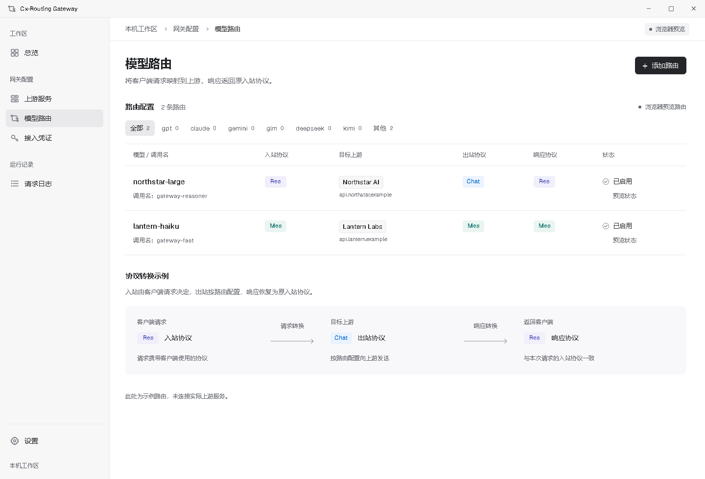

# Cx-Routing Gateway

Cx-Routing Gateway 是 Windows 桌面应用与本机模型网关，用于管理多个上游服务、统一本机模型入口，并按路由配置转发或转换请求。

| 项目 | 信息 |
| --- | --- |
| 当前源码/桌面包版本 | `1.1.10` |
| 已验证发行平台 | Windows x64 |
| 桌面技术 | Electron、React、TypeScript |
| 上游协议 | Chat Completions、Responses、Messages |

正式安装包和发行说明以 [GitHub Releases](https://github.com/AiaiJei/Cx-Routing-Gateway/releases) 中实际发布的资产为准。版本号反映当前源码；它本身不表示对应版本的发行包已经发布。

## 下载与开源

仓库以 [Apache-2.0](LICENSE) 开源。无需 GitHub 账号或访问令牌即可查看源码和下载公开 Releases。普通访问者可阅读、克隆和 Fork，不能直接推送、合并或发布；现有协作者仅保留只读访问，仓库管理员负责维护和正式发布。

- [正式发布与下载](https://github.com/AiaiJei/Cx-Routing-Gateway/releases/latest)：Windows x64 安装版和 Portable 便携版。
- 安装版适合固定安装；Portable 可直接运行，关闭窗口后驻留托盘，完整退出请使用托盘菜单。
- 两种版本沿用同一本机数据目录，更新前保留原程序。发行资产提供 SHA-256 清单；应用下载更新时也校验 GitHub 资产摘要。
- 开发与内测验证使用独立数据目录；发布成功不表示已替用户切换 Codex 接入或验证所有上游模型。

1.1.10 包含 Codex 直连/网关方案管理、模型与凭证记忆、推理区间、默认文本和图片、模型目录生效诊断、跨协议工具续轮及加密推理历史兼容。当前用户代理和账户配置由用户自行管理，程序不会因版本更新自动切换。

## 界面截图

以下截图来自 1.1.1 本地浏览器预览，使用仓库内置的只读示例数据，不代表真实上游请求或运行时状态。

### 总览


### 模型路由



### 设置


## 功能

- **上游管理：** 添加和维护上游服务，发现模型并执行连通测试；上游凭证保存在本机加密存储中。
- **模型路由：** 横向选择上游服务，在统一列表中选择模型；同名模型只选一次，自动对应所选上游中提供它的服务。协议集中设置，每个模型可设推理等级的最低—最高允许区间，并配置上游优先级和故障切换。
- **协议适配：** 提供 Chat Completions、Responses 和 Messages 接入；支持同协议转发，以及已验证的文本、图片、SSE、本地工具定义和结果续轮转换。
- **本机凭证：** 创建、限定模型范围、轮换和撤销客户端 Key；界面隐藏密钥，只在创建时显示完整 Key。
- **Codex：** 管理官方及第三方 Responses 直连方案，或启用 CX-RG 多模型网关；支持配置导入、供应商编辑、确认启用和备份恢复。
- **请求记录：** 查看状态、耗时、首 Token 和可用的 Token 用量指标，并按条件筛选；日志不记录请求正文或密钥。
- **桌面设置与更新：** 调整本机日志保留条数；匿名读取公开 GitHub Releases，验证安装器 SHA-256 后由用户确认安装，无需仓库写入或发布权限。
- **托盘驻留：** 关闭主窗口后应用隐藏到系统托盘；单击托盘恢复窗口，托盘菜单可打开或完整退出应用。

## Codex 接入

“工作区 → Codex”顶部有 **Codex 直连 / CX-RG 网关** 两个入口。切换标签仅查看，不会修改配置；“生效中”标记对应当前磁盘配置。各模式区域直接提供启用按钮，点击后预览变更并确认，成功或失败都会明确反馈。

**Codex 直连**表示 Codex 直接访问供应商，包含官方默认服务和原生 Responses 第三方 API。可读取当前配置并保存为方案，或新增名称、地址、Key、模型列表和默认模型；保存方案不自动启用。普通方案支持编辑、复制和删除，当前使用及上次直连方案受到保护。含高级鉴权或外部模型目录的配置按接入字段保存为只读方案，避免导入时丢失原有设置。官方账号登录是辅助入口，不是直连的前提；切回官方默认不强制改写登录方式，不删除 `auth.json`。

直连方案库使用系统安全存储加密保存在 Gateway 用户数据目录的 `codex-direct-profiles.enc`，Key 不返回页面。安全存储不可用时会明确拒绝保存凭证方案。官方 CLI 状态未知或读取失败不会阻挡一般方案管理；真正的登录操作由官方 Codex 处理，可能更新其已有登录。

**CX-RG 网关**使用现有 Gateway 路由。在该模式区域勾选一个或多个已启用的 Responses 路由，并指定默认模型。输入或复用 Gateway 客户端 Key，或明确创建覆盖所选模型的专用 Key，再点击“保存并启用网关”。这里使用接入凭证，不使用上游服务 API Key。启用时校验全部模型权限，不发起模型生成请求。客户端在模型路由允许的区间内选择推理强度。

网关模型、默认模型及凭证来源会自动记住，切换页面、接入模式或重启后可恢复。记忆文件按 `CODEX_HOME` 区分，只保存模型/凭证编号等选择，不保存 Key 原文，也不会自动启用配置。失效的模型和凭证会提示重新选择。

Gateway 凭证下拉框可选择已有凭证。新建或轮换后的 Key 加密保存在现有本机凭证库；选择后由主进程读取、核对摘要和权限，原文不返回下拉列表。旧版只保存摘要的 Key 无法逆向还原，可补录原 Key 验证保存，或明确读取当前 Codex 配置中可匹配的 Gateway Key；不会自动轮换或改变其他客户端正在用的凭证。

在“模型路由”设置每个模型的最低—最高推理区间：`none / minimal / low / medium / high / xhigh / max`。区间内保留客户端选择，越界调整到最近边界；未传或空白值按 `medium` 调整到区间内。旧路由的“不限”模式维持原行为。上述顺序用于网关转发限制，不保证所有模型接受所有档位；以模型官方说明为准。Codex 0.167 的 `Ultra` 是界面别名，会转换为 `max` 或该模型支持的其他值；`persistent` 也不作为有序强度。网关按实际收到的参数执行限制，不把 `max` 反向升为 `ultra`。选择值随请求转发到 Responses、Chat 或 Messages 对应字段，日志记录实际采用的等级。

路由保存后立即限制新请求；Codex 模型目录需要回到 Codex 页重新“保存并启用网关”，再完全退出并重启 Codex，单独新建会话不保证重载。生成的 v5 模型目录按各模型的能力与路由区间交集提供推理选项，并保留旧 v1–v4 目录读取。已有 Codex 推理设置保留，网关仍会限制旧会话传入的越界值。

“模型路由 → 编辑 → 模型能力”可填写上下文窗口、最大输出、文本/图片输入、工具调用及支持的推理档位。请按供应商官方资料填写；留空表示未知，明确不支持会在转发前拒绝相应请求，不从模型名称猜参数。上下文写入 Codex 目录，客户端默认按95%预留空间；最大输出由网关执行，未传时补上限，超过时降到上限，较小值保留。能力表支持的档位与路由区间必须有交集；未知旧模型维持原兼容默认。一个路由有多个候选上游时，应填写这些目标都能满足的能力。

输入能力现在默认“文本和图片”，显式“仅文本”保持不变；这个默认也适用于本产品新建的直连模型目录。旧目录不会被后台改写，需重新保存启用后更新。工具调用“按上游处理”（原“未知”）表示网关继续转发工具请求，由上游决定是否支持，不代表已经验证。Codex页的“模型能力目录”显示磁盘中实际写入的图片能力，并区分目录一致、待重新应用、文件/服务不可用及当前接入未应用目录；它不声称已经检查运行中的客户端缓存。其他代理管理器改写了接入配置时，模型路由页的能力不会自动应用到那套接入。

Codex 默认会附带由官方 Responses 服务执行的 `web_search`。当选中的网关路由包含 Chat 或 Messages 出站时，启用确认会说明关闭这项官方托管网页搜索，并写入 `web_search="disabled"`；本机函数、命名空间、自定义工具和客户端工具发现仍可用。切回直连或纯 Responses 网关时恢复原搜索设置。独立 `--profile` 文件及启动参数不自动修改，仍可能覆盖设置。旧会话继续携带托管搜索时会收到明确错误，请重新应用配置并新建会话；不会丢弃请求的工具或伪造搜索结果。

Res→Chat/Messages 保留开发者指令及本地工具调用/结果续轮，正确报告输出额度耗尽。公开推理摘要保留为转换元数据，不混入用户正文；目标协议没有等价字段时不发送摘要。旧供应商的推理密文不再阻断跨协议请求：保留可读对话和工具历史，略过目标无法使用的密文并记录安全计数，不解密或伪装成普通消息。Res直通仍保留密文。压缩和未知业务历史仍明确拒绝。

图片支持HTTPS地址与PNG/JPEG/WebP/GIF的base64数据，按Res/Chat/Messages协议转换，不由网关下载。Chat仅支持user消息中的图片，图片工具结果安全拒绝；Messages不能表达的high/low图片detail会记录`image_detail_omitted`兼容提示，图片本体保留。文件ID、音视频及其他未实现媒体明确拒绝。

进入网关前，当前直连接入会先保存为加密方案；在网关内多次修改模型也不会覆盖这个返回位置。回到直连时启用所选方案，仅恢复接入字段，保留期间新增的 MCP、Hook、项目和其他设置。结构化直连方案与网关均可生成 Codex 原生模型目录，默认模型同时写入配置并设为目录最高优先级。不可变目录随配置备份保留；“配置详情与恢复”提供辅助查看和原文件恢复。

目标文件为 Gateway Desktop 进程环境中的 `CODEX_HOME/config.toml`，未设置时使用当前用户的 `~/.codex/config.toml`。只更新接入模式、模型和目录等相关字段；通过 TOML 结构定位，保留无关字段、注释、原有推理设置及数值和时间的原始表示。受影响的行内表可能调整空格。不能安全修改的表结构会在预览时拒绝。原文件先完整备份，恢复时按原字节还原。切换模式不改 `auth.json` 或登录状态；只有用户明确启动的官方登录流程会由 Codex 更新其账号凭据。

作用范围是**当前用户的该 Codex 配置目录**：影响使用同一目录的 CLI/Desktop，不是系统全局设置，也不是当前项目配置。页面与启用确认会显示实际路径；已有会话、profile 和启动参数仍可能影响最终行为。

此接入方式将客户端 Key 写入 Codex 提供商的 `experimental_bearer_token` 字段，配置文件和包含它的历史备份都应视为凭证文件。确认弹窗会说明这一点；状态、预览和错误消息不返回 Key。Codex 官方更推荐通过 `env_key` 从环境变量提供凭证；需要这种方式时，可在接入凭证页面创建 Key 后按[官方配置说明](https://developers.openai.com/codex/config-reference/)手动配置。

应用和恢复都检查文件版本。如果文件在预览后被外部程序修改，操作会停止，需刷新并重新预览；恢复也不会覆盖检查时发现的手动修改。备份保留在目标 Codex 目录下，Windows 下受目录继承的访问权限保护，未加密。程序内串行写入及替换前的版本检查不能替代操作系统级文件锁，无法完全排除其他程序在最后一刻改写文件的竞争。

保存成功仅说明配置已写入，请重启 Codex 并开启新会话确认接入；环境变量、配置 profile、启动参数和客户端版本仍可能影响最终行为。模型目录已通过本机 Codex 0.167.0 的目录接口验证；实际提供商模型能力还需实测。目录使用官方开源的通用编码指令，来源和许可证随程序保留，不声称未验证的模型能力。浏览器预览没有本机配置写入、恢复、登录或创建凭证能力。

## 运行方式

需要 Node.js 22.13 或更高版本（推荐 Node.js 24），以及 Windows x64 桌面环境。

```powershell
npm ci --prefix apps/desktop
npm --prefix apps/desktop run desktop:dev
```

Electron 启动时会同时启动本机 Control API 和 Gateway。默认分别监听 `127.0.0.1:4319` 与 `127.0.0.1:4318`。开发浏览器预览使用只读示例数据，不会连接真实上游。

构建桌面包：

```powershell
npm --prefix apps/desktop run desktop:dist
```

## 能力范围与安全

- 已验证的桌面发行目标为 Windows x64；其他操作系统尚未完成发行验证。
- Chat、Responses、Messages 的协议能力并不完全等价。文本、本地工具续轮和上述图片格式已进行本地链路验证；托管工具、签名推理状态、文件及音视频等仍有转换边界。配置与本地fixture不等于真实供应商能力验收，具体以任务验收文档为准。
- Gateway 和本机控制服务仅绑定 loopback。客户端调用需要客户端 Key；上游私网地址默认拒绝，只有显式信任后才可连接。
- 公开 Releases 的更新检查和下载不需要 GitHub Token；应用不读取旧版保存的更新令牌，也不包含维护者凭证。GitHub 匿名 API 有速率限制，限流时可稍后重试或直接从 Releases 下载。
- Windows 发行包当前未进行代码签名。首次运行时请确认来源和文件哈希。

## 验证

```powershell
npm test
npm --prefix apps/desktop test
npm --prefix apps/desktop run build
```

架构、API 和协议边界见 [架构说明](docs/architecture.md)、[Gateway 说明](services/gateway/README.md)、[本机控制服务说明](services/local-control/README.md) 与 [验收清单](docs/acceptance-checklist.md)。
