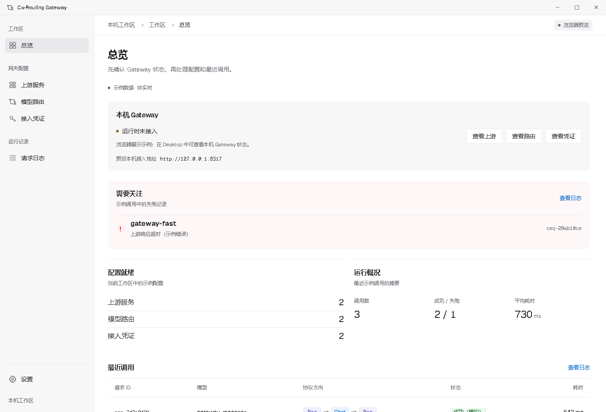
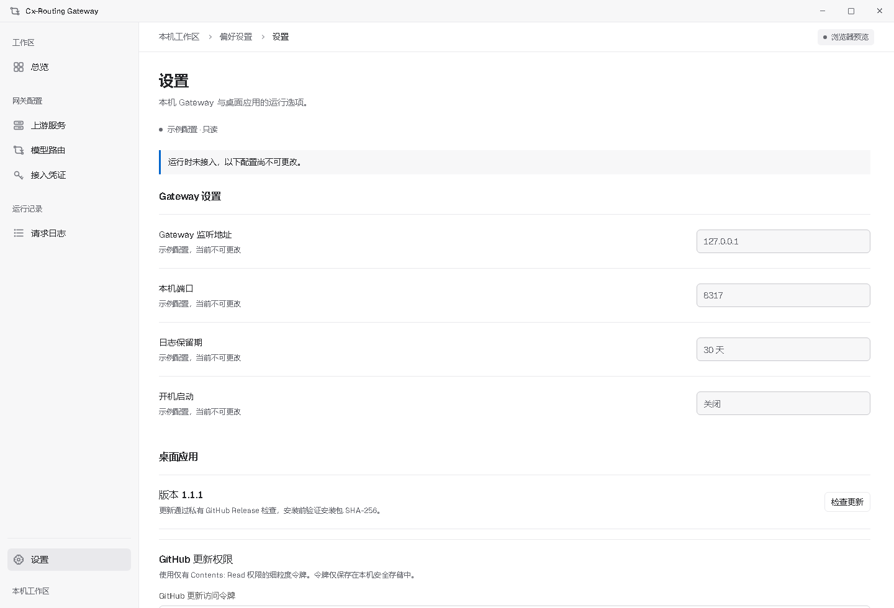

# Cx-Routing Gateway

Cx-Routing Gateway 是 Windows 桌面应用与本机模型网关，用于管理多个上游服务、统一本机模型入口，并按路由配置转发或转换请求。

| 项目 | 信息 |
| --- | --- |
| 当前源码/桌面包版本 | `1.1.1` |
| 已验证发行平台 | Windows x64 |
| 桌面技术 | Electron、React、TypeScript |
| 上游协议 | Chat Completions、Responses、Messages |

正式安装包和发行说明以 [GitHub Releases](https://github.com/AiaiJei/Cx-Routing-Gateway/releases) 中实际发布的资产为准。版本号反映当前源码；它本身不表示对应版本的发行包已经发布。

## 界面截图

以下截图来自 1.1.1 本地浏览器预览，使用仓库内置的只读示例数据，不代表真实上游请求或运行时状态。

### 总览



### 模型路由


### 设置



## 功能

- **上游管理：** 添加和维护上游服务，发现模型并执行连通测试；上游凭证保存在本机加密存储中。
- **模型路由：** 为本机模型名配置一个或多个上游目标、入站/出站协议、优先级和故障切换策略；可按 GPT、Claude、Gemini、GLM、DeepSeek、Kimi 或其他系列筛选。
- **协议适配：** 提供 Chat Completions、Responses 和 Messages 接入；支持同协议转发，以及已实现范围内的文本转换、文本 SSE 和单函数工具调用转换。
- **本机凭证：** 创建、限定模型范围、轮换和撤销客户端 Key；界面隐藏密钥，只在创建时显示完整 Key。
- **Codex 路由管理：** 选择 Responses 路由，预览并确认应用到本机 Codex 配置，保留原文件备份并检查恢复冲突。
- **请求记录：** 查看状态、耗时、首 Token 和可用的 Token 用量指标，并按条件筛选；日志不记录请求正文或密钥。
- **桌面设置与更新：** 调整本机日志保留条数；更新检查连接私有 GitHub Release，验证安装器 SHA-256 后由用户确认安装。
- **托盘驻留：** 关闭主窗口后应用隐藏到系统托盘；单击托盘恢复窗口，托盘菜单可打开或完整退出应用。

## Codex 接入

在 Desktop 的“Codex 路由与管理”中选择一条已启用、入站协议为 Responses 的模型路由。填入已有 Gateway 客户端 Key，或明确点击创建专用 Key；这里使用接入凭证，不使用上游服务的 API Key。预览后确认应用，应用会通过本机 Gateway 的模型列表检查 Key 和模型范围，不会发起模型生成请求。

目标文件为 Gateway Desktop 进程环境中的 `CODEX_HOME/config.toml`，未设置时使用当前用户的 `~/.codex/config.toml`。应用只更新模型别名、`cx_routing_gateway` 提供商、本机 Gateway 地址和明确选择的推理强度；通过 TOML 结构定位接入字段，保留无关字段、注释及数值和时间的原始表示。受影响的行内表可能调整空格。不能安全修改的表结构会在预览时拒绝。原文件的完整内容先保存到本机备份，恢复时按原字节还原。不会改动 `auth.json`、登录状态、系统环境变量或项目级配置。

此接入方式将客户端 Key 写入 Codex 提供商的 `experimental_bearer_token` 字段，配置文件和包含它的历史备份都应视为凭证文件。确认弹窗会说明这一点；状态、预览和错误消息不返回 Key。Codex 官方更推荐通过 `env_key` 从环境变量提供凭证；需要这种方式时，可在接入凭证页面创建 Key 后按[官方配置说明](https://developers.openai.com/codex/config-reference/)手动配置。

应用和恢复都检查文件版本。如果文件在预览后被外部程序修改，操作会停止，需刷新并重新预览；恢复也不会覆盖检查时发现的手动修改。备份保留在目标 Codex 目录下，Windows 下受目录继承的访问权限保护，未加密。程序内串行写入及替换前的版本检查不能替代操作系统级文件锁，无法完全排除其他程序在最后一刻改写文件的竞争。

保存成功仅说明配置已写入，请重启 Codex 并开启新会话确认接入；项目级配置、启动参数和客户端版本仍可能影响最终使用的提供商。浏览器预览没有本机配置写入、恢复或创建凭证能力。

## 运行方式

需要 Node.js 22.13 或更高版本（推荐 Node.js 24），以及 Windows x64 桌面环境。

```powershell
npm ci --prefix apps/desktop
npm --prefix apps/desktop run desktop:dev
```

Electron 启动时会同时启动本机 Control API 和 Gateway。默认分别监听 `127.0.0.1:4319` 与 `127.0.0.1:4318`。开发浏览器预览使用只读示例数据，不会连接真实上游。

构建桌面包：

```powershell
npm --prefix apps/desktop run desktop:dist
```

## 能力范围与安全

- 已验证的桌面发行目标为 Windows x64；其他操作系统尚未完成发行验证。
- Chat、Responses、Messages 的协议能力并不完全等价。复杂工具结果链、多模态和结构化输出转换不在当前支持范围内；具体行为以项目的协议与验收文档为准。
- Gateway 和本机控制服务仅绑定 loopback。客户端调用需要客户端 Key；上游私网地址默认拒绝，只有显式信任后才可连接。
- 私有仓库的更新检查要求用户配置具有 `Contents: Read` 权限的细粒度 GitHub Token。Token 使用系统安全存储保存在本机，应用不包含共享维护者 Token。
- Windows 发行包当前未进行代码签名。首次运行时请确认来源和文件哈希。

## 验证

```powershell
npm test
npm --prefix apps/desktop test
npm --prefix apps/desktop run build
```

架构、API 和协议边界见 [架构说明](docs/architecture.md)、[Gateway 说明](services/gateway/README.md)、[本机控制服务说明](services/local-control/README.md) 与 [验收清单](docs/acceptance-checklist.md)。
