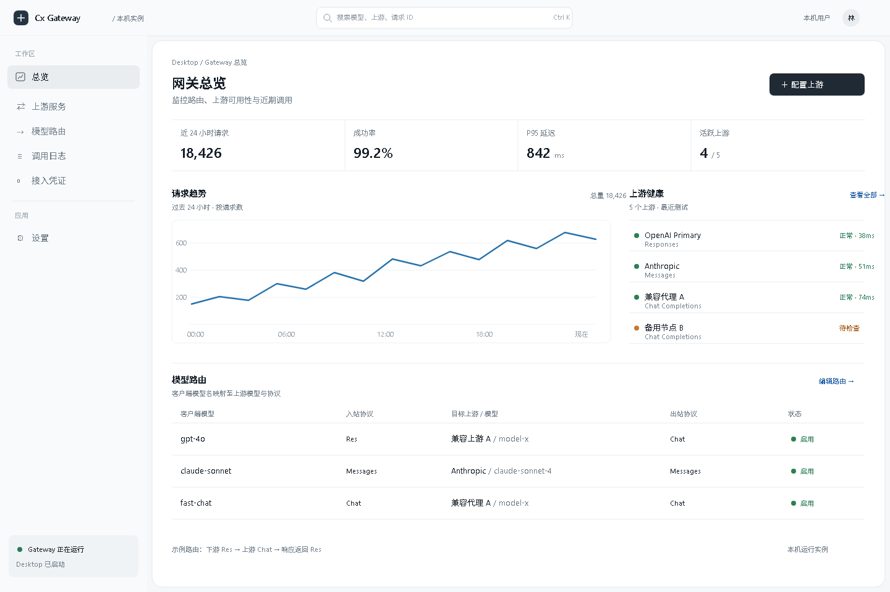
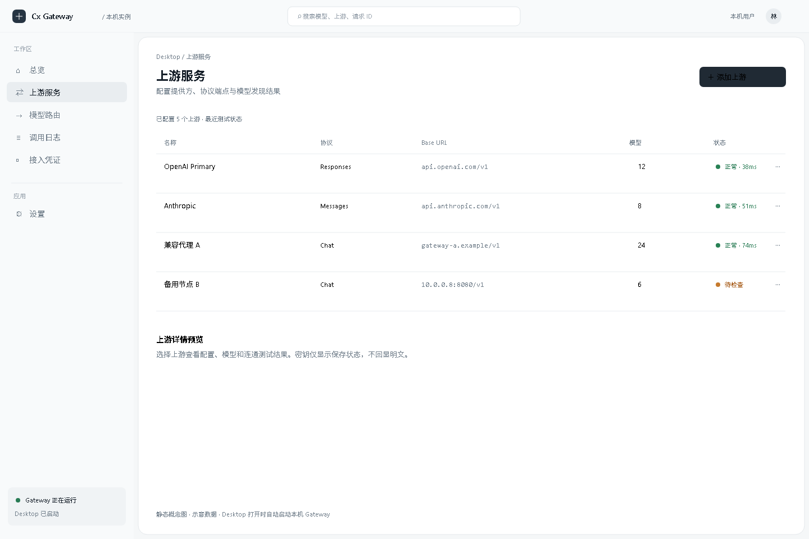
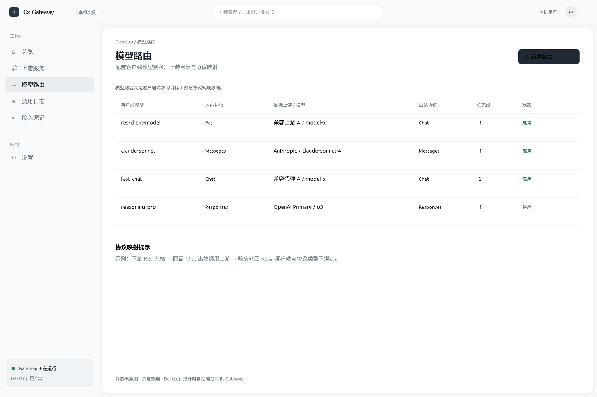
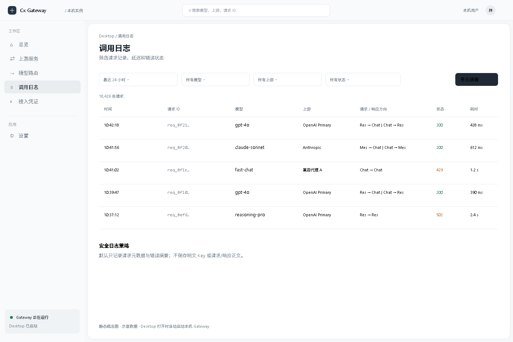
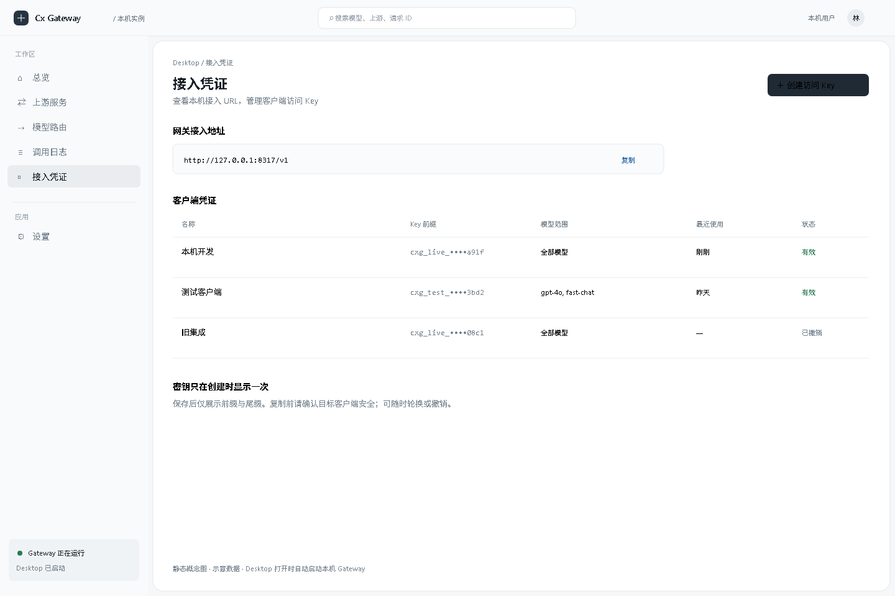
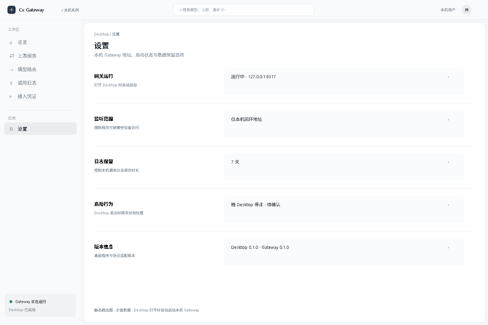

# Desktop 页面概念图

以下每张图都是独立渲染的静态页面稿。数据均为示意，非运行界面。

## 总览

SVG：`gateway-overview.svg`

## 上游服务

SVG：`upstreams.svg`

展示客户端请求协议作为入站协议、路由配置作为上游出站协议，并将响应转换回原入站协议。通用示例：下游以 Res 入站 → 路由配置 Chat 出站 → 响应转回 Res；协议与具体客户端无绑定关系。

## 模型路由

SVG：`routes.svg`

## 调用日志

SVG：`logs.svg`

## 接入凭证

SVG：`credentials.svg`

## 设置

SVG：`settings.svg`
