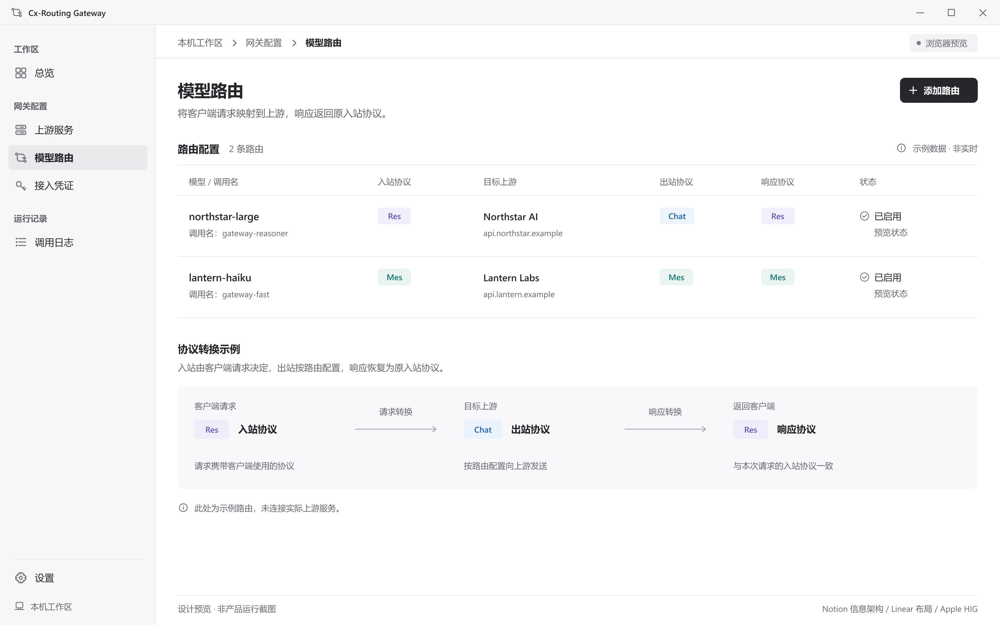

# Desktop 工作区改版：Notion × Linear × Apple HIG

- 项目 / 仓库：Cx-Routing Gateway / `AiaiJei/Cx-Routing-Gateway`
- 任务：`CXRG-WORKSPACE-DESIGN-2026-11-19`
- 基线：`master`，`9807fd32b27c436dde55129308799ec4d6187643`（PR #5 已合并）
- 分支：`codex/desktop-workspace-redesign`
- 状态：**2026-11-19 Owner 已要求按精修渲染图执行，目标版本 1.0.1；设计获批，产品最终验收另行记录。**

## 目的与要求

用户要求建立专属 PR，采用 Notion 的框架与架构、Linear 的布局和 Apple Human Interface Guidelines 的组件规范。目标是让现有六页形成一致的工作区组织、紧凑的操作布局和可预测的控件行为。

用户已明确选择“采用信息架构，改版现有六页”。据此，“框架与架构”指产品信息架构与前端职责边界，不推断 Notion 的内部技术栈；可编辑块与用户创建的嵌套页面不纳入。范围选择已确认，本文具体布局与组件设计仍待 Owner 审阅。

## 参考分工

以下官方页面于 2026-11-19 通过浏览器读取。它们是设计参考，不是代码依赖。

| 参考 | 可见依据 | 本项目采用 | 边界 |
| --- | --- | --- | --- |
| [Notion 中文官网](https://www.notion.com/zh-cn)、[工作空间设置](https://www.notion.com/zh-cn/help/category/meet-your-workspace) | 工作区集中资源，页面与内容分类组织 | 本机工作区 → 功能分组 → 页面 → 页面内容区块 | 区块是可复用展示区域；不引入编辑器、数据库产品、多账号或协作系统 |
| [Linear](https://linear.app/) | 官网产品示例可见分组侧栏、紧凑上下文栏、主内容与按需详情 | 弱化导航、突出当前对象；统一页头、工具栏、列表 | 采用产品布局原则，保留现有浅色主题，不复制营销页或品牌 |
| [Apple HIG](https://developer.apple.com/design/human-interface-guidelines/)、[Components](https://developer.apple.com/design/human-interface-guidelines/components)、[Layout and organization](https://developer.apple.com/design/human-interface-guidelines/layout-and-organization) | 熟悉、一致的系统组件体验；包含列表、表格、分栏、标签等类别 | 按钮层级、输入反馈、选择状态、弹窗、键盘和焦点行为 | HIG 是规范，不是可直接安装的 React 组件库；由现有 React 组件实现 |

下述尺寸、分组与配色为项目设计决策，不声称是官方强制值。

## 现状与复用

当前为 Electron + React 18 + React Router + TypeScript + Vite，普通 CSS 与本地 Geist 字体。PR #4 已接通本机控制面，PR #5 已提供 HIG 风格控件及真实路由测试。

| 职责 | 现有入口（相对 `apps/desktop/src/`） | 采用方式 |
| --- | --- | --- |
| 路由装配 | `App.tsx` | 保留六条 URL 与页面职责 |
| 工作区外壳 | `components/AppShell.tsx`、`WindowTitleBar.tsx`、`NavigationIcon.tsx` | 外壳负责分组导航、上下文与响应式 |
| 页头与反馈 | `components/PageHeader.tsx` | 复用 PageHeader、FixtureNotice、SearchField、EmptyResult；按需按职责拆文件 |
| 基础交互 | `Button.tsx`、`TextField.tsx`、`CustomSelect.tsx`、`SegmentedControl.tsx`、`Modal.tsx`（均在 components） | 统一既有接口和样式，不另建同名控件体系 |
| 协议与状态 | `components/ProtocolBadge.tsx`、`RuntimeIndicator.tsx`、`RouteTestDialog.tsx` | 保留协议标签、运行状态、真实测试语义 |
| 数据层 | `data/use-workspace.ts`、`data/workspace-client.ts`、`domain/types.ts` | 复用 fixture/runtime 选择和类型；外壳不承载网络调用 |
| 视觉基础 | `styles/tokens.css`、`styles/app.css` | 统一间距、层级与密度；不更换框架、字体包或样式库 |

`useWorkspace` 当前以 fixture 初始化后读取工作区，初始状态不能呈现为真实运行成功。当前数据接口不因布局修改而变化。

## 方案比较

1. **仅改颜色与圆角**：变更小，但不能解决信息层级和布局密度。
2. **重组外壳与六页布局，复用现有业务组件（作者推荐）**：覆盖三个参考的分工，集中改动展示层，沿用已有回归基础。
3. **增加块编辑器、嵌套页面和多工作区**：需新增内容模型、存储和编辑能力，超出现有网关改版默认范围。

用户已选择信息架构与现有六页改版，并在查看精修图后明确要求执行，与方案 2 一致。

## 信息架构

只使用现有六个目的地，保留导航标签与 URL；分组只承担视觉和语义组织。

```text
本机工作区
├─ 工作区       总览 /
├─ 网关配置     上游服务 /upstreams
│              模型路由 /routes
│              接入凭证 /credentials
├─ 运行记录     调用日志 /logs
└─ 底部偏好     设置 /settings
```

左侧继续不放产品标题，沿用 PR #5 决策。产品名保留在窗口标题栏；页头显示 `本机工作区 / 当前分组 / 当前页面`，右侧显示运行状态。本机工作区是范围标签，不制作没有功能的切换器。当前页面具备 `aria-current`；内容区只有一个 h1。

同一份静态导航元数据为分组与上下文路径供值，避免两套名称漂移；无需新的全局状态库。

## 布局与视觉

[模型路由页静态示意](../../concepts/workspace-redesign.svg)



2026-11-19 根据用户“精修这个渲染图”的要求更新静态设计：统一导航图标、文本基线、协议标签和表格密度；将协议说明改为三段路径图，设计注释收为页脚细行。PNG 是 2 倍分辨率的静态导出，非实际产品截图。

```text
┌──────────── Cx-Routing Gateway · 窗口操作 ───────────────────────┐
│ 分组侧栏      │ 本机工作区 / 网关配置 / 模型路由    运行状态     │
│ 总览          ├───────────────────────────────────────────────┤
│               │ 模型路由                         [添加路由]    │
│ 网关配置      │ 页面说明、数据来源                            │
│ 上游服务      │ 模型 / 入站 / 目标上游 / 出站 / 响应 / 状态   │
│ 模型路由      │ northstar-large  Res → Chat → Res             │
│ 接入凭证      │ lantern-haiku    Mes → Mes → Mes              │
│               │                                             │
│ 运行记录      │ 协议说明；详情和编辑按需打开                  │
│ 调用日志      │                                             │
│ 设置          │                                             │
└───────────────┴─────────────────────────────────────────────┘
```

示意图使用仓库 fixture 的模型、上游和协议，状态明确为预览。它是设计材料，不是运行截图或功能验证。

- 桌面侧栏约 224px，文字配 16–18px 线形图标；分组名 12px，导航行 34–36px。
- 上下文栏约 48px；桌面内容左右边距 32px。1440px 下 `224 + 32 + 1152 + 32 = 1440`，标题、工具栏、表格共用边缘；窄屏按下文单独缩减。
- 白色工作平面、浅中性侧栏、细分隔线和中性选中背景；减少页面套卡片，不引入装饰渐变或玻璃效果。
- 保留 Geist 与中文系统回退：标题 22–24px、分区 16px、正文 14px、辅助 12–13px；数字用 tabular figures，耗时列右对齐。
- 桌面按钮 32–36px；单页至多一个主要创建/保存动作。行操作保留明确文本，不变成难以发现的纯图标。
- 状态与协议承担主要颜色；现有 Res/Mes/Chat 色彩语义一致，颜色同时配文字，焦点环清楚。
- 设置使用分组标题与设置行。现有详情继续复用 Modal，不新增抽屉框架。
- 静态表格采用六列，宽度为 `270 / 152 / 254 / 146 / 142 / 188px`；两条示例数据共用 88px 行高。模型名与调用名分层；目标上游的第二行显示现有 baseUrl 的 hostname（不含用户信息、路径或查询参数）。协议胶囊统一 24px 高，状态继续明确为预览。
- 现有“协议转换示例”按客户端请求 → 目标上游 → 返回客户端三段表达；不添加新交互或数据请求。设计来源和“非产品运行截图”标记仅用于设计材料，不进入产品页脚。

## 六页落点

| 页面 | 首要问题 | 保留内容与操作 | 布局处理 |
| --- | --- | --- | --- |
| 总览 | 网关可用吗，哪里需要关注？ | Gateway、地址、配置入口、失败摘要、指标、最近调用 | 状态与操作在首屏，失败摘要优先，指标直接从现有数据计算 |
| 上游服务 | 哪个服务可用于路由？ | 搜索、新增、测试、模型发现、删除与反馈 | 搜索与结果数同一工具栏，名称/地址同列，反馈跟随操作 |
| 模型路由 | 请求走哪个上游，以什么协议返回？ | 模型、入站、目标优先级、出站、响应、状态，以及现有 CRUD/启停/测试 | 保留六个核心字段和目标顺序；真实模式操作区域清楚可见 |
| 调用日志 | 哪次失败，关联上下文是什么？ | 搜索、成功/失败筛选、计数、时间/ID、模型、凭证、协议、结果、耗时、详情 | 统一工具栏与列表；详情继续脱敏 |
| 接入凭证 | 哪个客户端能访问哪些模型？ | 名称、脱敏预览、scope、创建/使用信息、创建/轮换/撤销 | 列表按名称与作用域组织；新密钥显示行为保留，不新增持久化或日志输出 |
| 设置 | 哪些运行选项可以调整？ | 本机配置、日志保留、版本/更新、说明 | 分组设置行与就近保存/错误反馈；未接通能力仍明确禁用 |

不为不存在的功能添加搜索、导出、分享、通知、账号头像或装饰菜单；页面筛选由页面管理。

## 组件行为与状态

| 组件 | 约定和回归重点 |
| --- | --- |
| Button | 保留 primary/secondary/tertiary/accent/danger；pending 禁止重复提交；破坏性操作文本明确 |
| TextField / SearchField | 标签与可访问名称、错误/提示关联、类型范围与已有校验保留 |
| CustomSelect | 单选/多选、SVG 箭头、勾选、键盘行为保留；Escape 先关列表，不连带关闭外层弹窗 |
| SegmentedControl | 用于同页状态筛选；保留选中语义和方向键，不替代主导航 |
| Modal | 保留 focus trap、初始焦点、关闭后恢复，以及 Esc/背景点击的条件控制 |
| RouteTestDialog | 默认 `请回复OK` 可编辑；费用提示；发送中不能关闭或重复发送；保留文本、HTTP 状态、request ID、耗时与错误 |
| RuntimeIndicator / FixtureNotice | 预览、启动、运行、停止、异常、读取失败分别标明，fixture 不伪装 runtime |
| 列表 / 分组区 | 加载、空、筛选无结果、错误分别反馈；0 就是 0，缺失为 —；不造 KPI 或增长率 |

新增基础件前先证明既有组件无法承担职责。只为变化的行为补充有价值的回归，不写镜像 CSS 或重复实现逻辑的测试。

## 窄屏与可访问性

- 1100px 以下折叠侧栏，沿用菜单状态与 Escape 路径，补齐实际缺失的焦点行为。
- 390px 下边距 16px，交互目标至少 44px；标题动作和筛选可在各自区域换行。
- 宽表格放在有可访问名称的局部横向滚动容器，保留全部字段，不隐藏协议或优先级；页面本身不横向溢出。
- 弹窗限制在视口内，长表单滚动、操作可到达；保留 Tab/Shift+Tab、Esc 和选择器方向键行为。
- 保留 skip link、主内容焦点、Windows 标题栏拖拽与窗口按钮；控件不误入拖拽区。
- 动效只做控件反馈，尊重减少动态效果设置，不增加页面入场动画。

## 依赖、鉴权和影响范围

```text
App / AppShell → 业务页面 → useWorkspace / WorkspaceClient
                               ↓（Desktop）
                        preload IPC → Electron main
                               ↓
                         Local Control / Gateway
```

实现预期限定 `apps/desktop/src/components/`、`pages/`、`styles/`、必要的静态导航元数据和对应测试。入口只组装，数据、鉴权和网络由现有层负责。

真实测试继续使用 IPC → Gateway、路由限定的内存临时凭证、既有日志/限流/超时行为。浏览器 fixture 不触发上游调用。不改协议转换、多上游切换、API/IPC 合同、存储结构，不新增 Notion/Linear 远程集成。

若实现必须越过展示层，应追加范围修订、原因与验收项后再改动；PR #5 的合并授权不继承到本 PR。

## 分阶段交付与角色

1. **现状与设计（本次 Draft PR）**：主 agent 负责引用核对、能力盘点、设计与合同；独立 reviewer 只读检查可执行性，留存 SHA、源路径、问题和处理结论。
2. **设计确认后制定计划**：在同一 PR 加入实现计划与合同修订；本稿不冒充已批准的实施计划。
3. **最小实现与即时检查**：外壳/tokens → 共享组件 → 六页布局，每阶段检查受影响行为。
4. **链路与独立审查**：运行验收矩阵，修复发现，区分 PASS、PARTIAL、NOT_RUN。
5. **Owner 验收与集成**：视觉/交互验收单独记录；转 Ready、合并、发布需后续授权。

## 实现验收矩阵（尚未执行）

| 项目 | 需要的证据 |
| --- | --- |
| 六页导航、分组、上下文；侧栏无产品标题 | 组件回归和逐页检查 |
| 1440×900、768×1024、390×844 | 当前生产构建六页截图，长名称/多目标/空状态，无页面级横向溢出 |
| 字体、对比度、焦点、禁用/加载/错误 | App lint、浏览器检查及人工截图审阅；警告解释或修复 |
| 表单、筛选、多选、弹窗、测试调用 | `npm --prefix apps/desktop test`；新增测试覆盖改变的行为 |
| 类型与生产资源 | `npm --prefix apps/desktop run build` |
| 运行时边界 | `npm test`；模拟 IPC 只证明 UI，实际 Desktop IPC 使用隔离配置单独验证 |
| Electron 窗口与 IPC | 窗口启动、标题栏、只读状态与隔离配置操作；不在用户生产配置上写入测试 |
| 真实 provider / 发布包 | 默认 NOT_RUN；需要时另列授权和结果，不用 fixture 截图替代 |
| 审查与验收 | 无未解决 Critical/Important；Owner 视觉验收另列 |

设计阶段仅验证文档与静态图；产品实施阶段按上表验证，并在任务记录中保存本次结果。

## 回退与归档

设计阶段可关闭 Draft PR 或仅回退本任务文档提交。实现保持展示层边界时，可回退专属 PR 的展示层提交恢复 PR #5 外观，无配置和凭证迁移。分支、worktree 和任务证据保留，清理需单独授权。

[任务与证据记录](../../tasks/2026-11-19-workspace-redesign.md)
